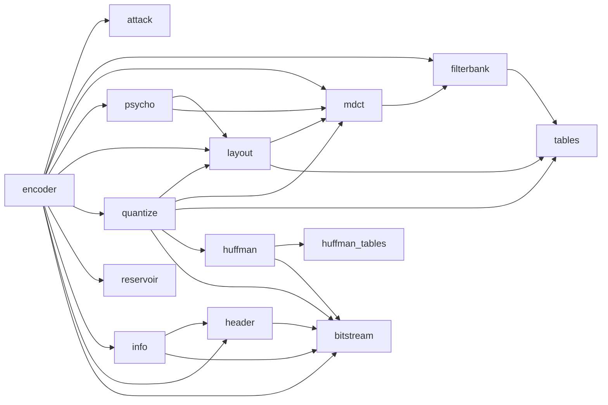

# craft-mp3 code map

A pure-Rust MP3 (MPEG-1 and MPEG-2 Layer III) encoder library, about 5 350 lines of source in `src/` (plus about 640 of tests and the example). No runtime dependencies; `#![forbid(unsafe_code)]`. Spec: [SPEC.md](../SPEC.md).

## Public API

`src/lib.rs` re-exports `Encoder`, `EncoderConfig`, `ConfigError`, `ENCODER_DELAY` (1057 samples) from `encoder`, `InfoTag` from `info`, and the public `header` module (`FrameHeader`, `SampleRate`, `ChannelMode`, `Bitrate`, `PaddingSchedule`, `HeaderError`).

```
EncoderConfig::new(rate, channels, kbps) | ::vbr(rate, channels, quality)
Encoder::new(config) -> Result<Encoder, ConfigError>
encoder.encode(&[f32] interleaved, &mut out) | encode_i16 | encode_planar
encoder.finish(&mut out) -> Option<InfoTag>;  tag.write_to(&mut mp3)
```

Users: WavCraft and SoundCraft (MP3 export), as a git dependency on a tag (SPEC M11).

## Modules

| Module | Owns | Uses |
|---|---|---|
| `encoder` | The public encoder: config checks, per-channel buffering, granule loop, VBR/CBR choice, lowpass, mid/side decision, finish and Info tag | attack, bitstream, filterbank, header, info, layout, mdct, psycho, quantize, reservoir |
| `attack` | Transient detection with lookahead for window switching (short blocks) | - |
| `filterbank` | Polyphase analysis filterbank (ISO/IEC 11172-3, Annex C.1.3) | tables |
| `mdct` | Windowed MDCT on each subband, long and short blocks, alias reduction | filterbank |
| `layout` | How a granule's 576 lines divide into scale-factor bands, long and short | mdct, tables |
| `psycho` | Psychoacoustic model: threshold of hearing, Bark-scale masking, tonality-dependent offset | layout, mdct |
| `quantize` | Quantization and the rate loop: scale factors, subblock gains, Huffman region split (LAME's `subdv_table`) | bitstream, huffman, layout, mdct, tables |
| `huffman` | Huffman coding of quantized lines (2.4.2.7) | bitstream, huffman_tables |
| `huffman_tables` | Huffman code tables (Table B.7); source to be recorded (#4) | - |
| `reservoir` | Frame assembly with the Layer III bit reservoir | - |
| `bitstream` | MSB-first bit packing (`BitWriter`, crate-private) | - |
| `header` (public) | The 32-bit frame header, bitrates, sample rates, channel modes, frame sizing and padding schedule | bitstream |
| `info` | The Xing/Info tag: frame and byte counts, seek table | bitstream, header |
| `tables` | Shared ISO constant tables (synthesis window D[i], Table B.3) | - |
| `bitwriter.rs` | Orphaned file, not compiled; removed by #2 | - |



## The wav2mp3 example

`examples/wav2mp3.rs`: reads a RIFF/WAVE file (`fmt `, `data` chunks), builds `EncoderConfig::new` or `::vbr`, encodes with `encode_i16`, writes the Info tag. Input hardening: #10.

## Tests and CI

- `tests/roundtrip.rs`: decode every sample rate, channel count and bitrate with symphonia and compare; pre-echo, CRC and Info-tag checks.
- `tests/stress.rs`: long and edge-case input (denormals, silence, clipping).
- Unit tests live beside each module.
- `.github/workflows/ci.yml`: fmt, clippy (`-D warnings`) and tests on Rust 1.99, plus the MSRV (1.88) test run. Linux only today; Mac and Windows are #3.

## Mac, PC and Linux

No platform code anywhere: the same source builds everywhere. What can differ per OS is only tooling: path separators and CRLF in test fixtures (none today) and the Windows shell in CI (#3 sets `shell: bash`).

## Open-source pieces

symphonia 0.5 (MPL-2.0, dev-dependency only) decodes in tests. minimp3 (CC0) or the ISO standard is the clean source for the Huffman tables (#4). LAME's published tables are credited where its constants are used.
